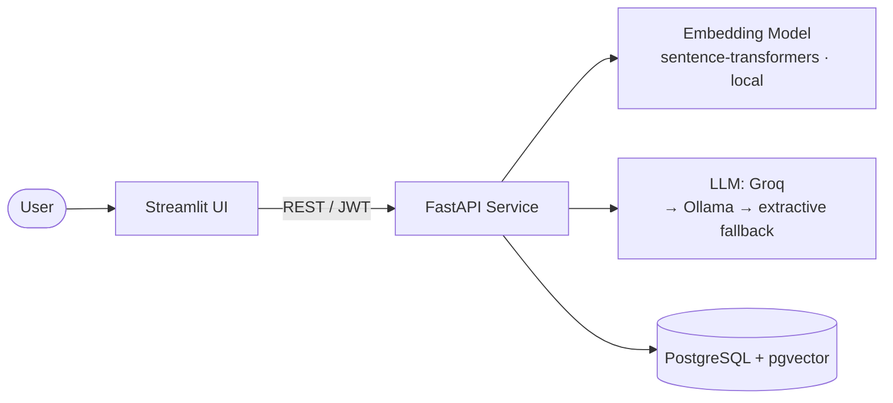
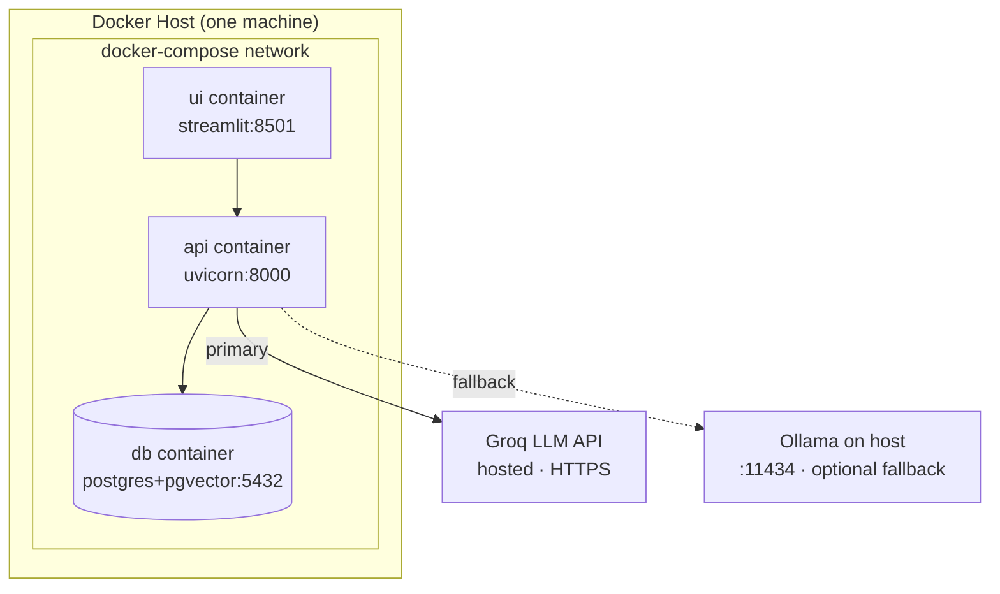
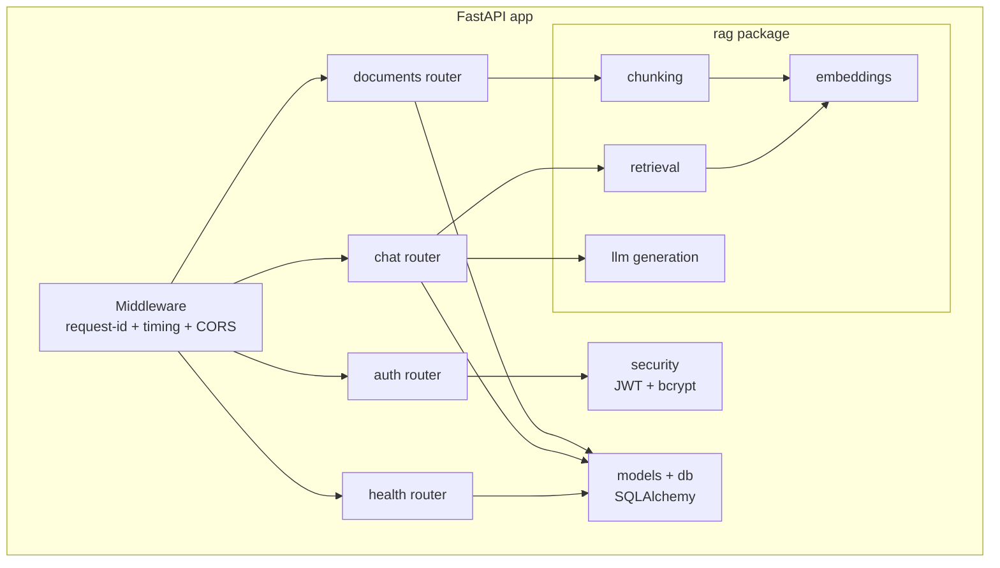
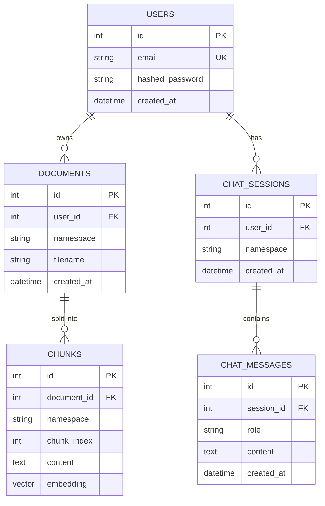
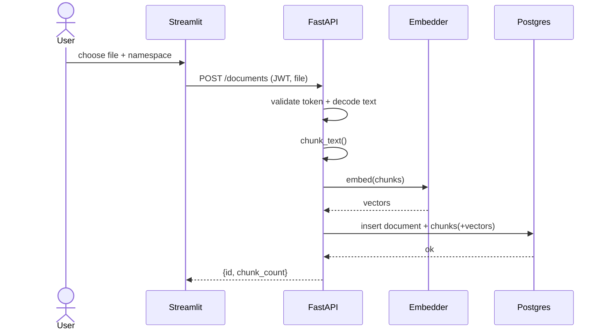
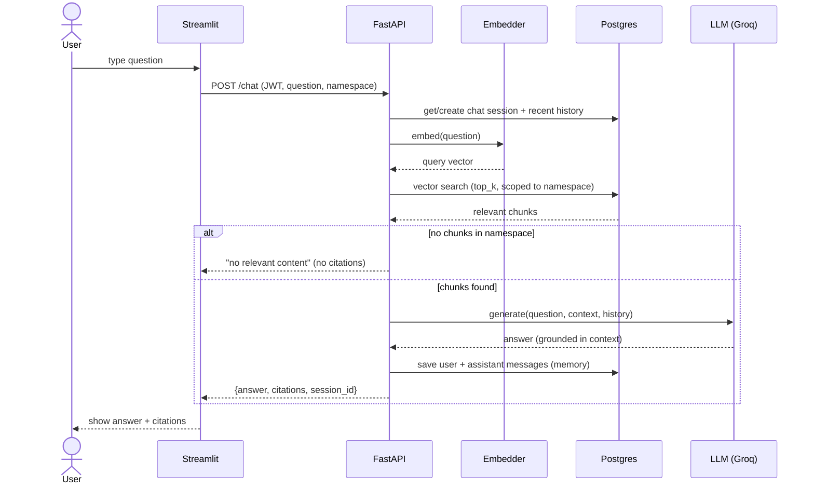

# Architecture & Diagrams

All diagrams are written in [Mermaid](https://mermaid.js.org/) so they render
directly on GitHub and in most Markdown viewers.

> **Datastore:** the system uses **PostgreSQL** with the **pgvector** extension
> as a single store for relational data and vector embeddings. Vector search is
> index-backed using pgvector's cosine-distance operator, scoped per namespace.
> The full stack is brought up with `docker compose up`.

---

## 1. High-Level Architecture

The API is the single brain: it authenticates users, embeds text, runs
namespace-scoped vector search, and calls the LLM to compose cited answers. The
LLM layer tries **Groq** first, then a local **Ollama**, then a built-in
**extractive** answerer — so it degrades gracefully and always responds.

---

## 2. Deployment Diagram

One `docker compose up` starts three containers (API, UI, PostgreSQL+pgvector)
on a private network. The API calls the hosted **Groq** LLM over HTTPS; if Groq
is unavailable it tries a local **Ollama**, then its built-in extractive
answerer, so generation never hard-fails.

---

## 3. Component Diagram

---

## 4. Database ER Diagram

---

## 5. Sequence Diagram — Document Upload (Ingestion)

---

## 6. Sequence Diagram — Ask a Question (Query/RAG)

